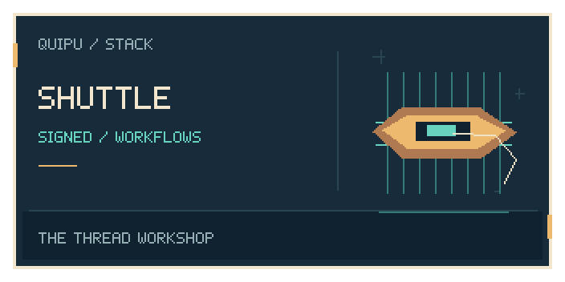

<p align="center"></p>

<p align="center">
  
</p>

# Shuttle

Signed agent workflows with append-only execution records. Steps link back
to work items and export their evidence to Quipu.

## Install

```sh
curl -fsSL https://raw.githubusercontent.com/scbrown/shuttle/main/install.sh | sh
```

Python 3.11+ with venv/pip, curl, and a Linux or macOS shell. Downloads the latest checksummed wheel into its own virtual environment;
command links go in `~/.local/bin`. Add that directory to `PATH`.

Set `STACK_INSTALL_ROOT` on the receiving shell for another prefix.
Pinned releases, alternatives, configuration and removal are in the
[installation and usage reference](docs/installation-reference.md).

## Try it

Check the installed workflow engine:

```sh
shuttle version
```

[Create a workflow](docs/installation-reference.md#quick-start) when you are ready
to register an agent identity. Installation does not enroll a key or run a workflow.

## Next steps

- [Tambo](https://github.com/intigraph/tambo): guided stack installation and verification.
- [Camayoc](https://github.com/scbrown/camayoc): governed memory and vocabulary.
- [Detailed examples and agent setup](docs/installation-reference.md).

**Load this repository’s graph:** public repository-pendant assets have not yet been verified. When a release supplies the archive, checksum and provenance, follow the [verified import workflow](https://scbrown.github.io/quipu/sharing/index.html): extract the share directory and use `quipu import SHARE_DIR --db repository.db`. Import stages knowledge; ROOT stays unchanged.

## The stack

<!-- stack-table:start -->

The Quipu stack is built around a governed, bitemporal knowledge store: shared
facts, decisions and work history your agents can query. Quipu can check writes
against your rules, records where each fact came from, and answers what was true
when.

| tool | what it gives your agents |
|---|---|
| [tambo](https://github.com/intigraph/tambo) | 🧰 Agent Platform Toolkit - installs and configures the quipu stack |
| [quipu](https://github.com/scbrown/quipu) | stores shared facts with provenance and history; can check writes against your rules |
| [camayoc](https://github.com/scbrown/camayoc) | prepares knowledge and vocabulary for Quipu, with checks before it is admitted |
| [quechua](https://github.com/scbrown/quechua) | shared vocabulary and shapes for interoperable knowledge |
| [chaski](https://github.com/scbrown/chaski) | reacts to graph changes and delivers governed notifications |
| [bobbin](https://github.com/scbrown/bobbin) | indexes your codebase and injects context from that index and Quipu knowledge |
| [yupana](https://github.com/scbrown/yupana) | shows code impact and can read policies from Quipu to govern agent actions |
| [desire-path](https://github.com/scbrown/desire-path) | turns agent mistakes into feature requests; works on its own without Quipu |
| [seeds](https://github.com/scbrown/seeds) | a work item tracker backed by the Quipu knowledge base |
| [shantytown](https://github.com/scbrown/shantytown) | runs crews of AI agents on work items, triggered by hand, on a schedule or by events; can share work and memory through Quipu |
| [rikuy](https://github.com/scbrown/rikuy) | live brief: status, graphs, watches and signed decisions over Quipu |
| [shuttle](https://github.com/scbrown/shuttle) | runs signed agent workflows and keeps their records in Quipu |

<!-- stack-table:end -->

[License](LICENSE).

## Agent orientation

Run `shuttle prime` for the embedded [agent primer](docs/agent-primer.md) and a bounded, read-only local summary. Use `--static`, `--brief`, `--section` or `--json` for focused output. The generated [Shuttle skill](skills/shuttle/SKILL.md) carries the same primer. Signing status is file metadata, without loading private keys or checking registration.
