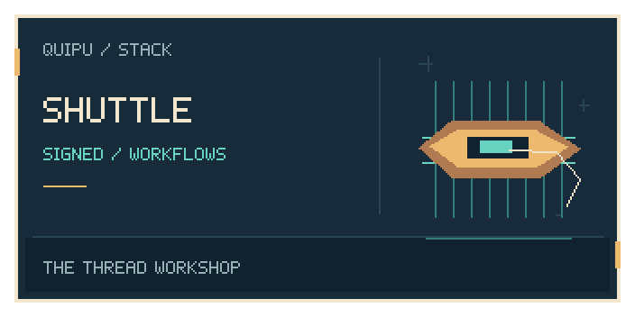

<p align="center"></p>

<h1 align="center">shuttle</h1>

<p align="center">
  <em>🧵 Workflows where every step is checked, signed and kept in Quipu.</em>
</p>

<p align="center">
  <a href="LICENSE"></a>
  <a href="https://github.com/intigraph/shuttle/actions/workflows/ci.yml"></a>
  <a href="https://github.com/intigraph/tambo"></a>
</p>

**Shuttle records workflow runs for people who run agents and need proof of
what each one did. It comes as a CLI and a small signing service.** You
declare a workflow as states and the steps between them. Shuttle refuses a
step that is not legal from the current state, signs each step that is, and
exports the history to Quipu, where anyone can check the signatures. It has no
daemon: a person, an agent or a timer advances a run.

## Why you would want it

- **Refuse a step out of order.** A run moves only along a step the workflow
  declares, and the refusal names the steps that are legal.
- **Prove which key signed each step.** Every transition carries an ed25519
  signature that `shuttle verify` checks from the graph, against public keys a
  person registered.
- **Keep history nobody can edit.** The local log is append-only. Exports land
  in monthly Quipu graphs, and a finished month can be frozen and still
  queried.
- **Let a work item do a step.** A step can open a Seeds work item and advance
  when that item closes.

## Install

```sh
curl -fsSL https://raw.githubusercontent.com/intigraph/shuttle/main/install.sh | sh
```

This needs Python 3.11 or newer with `venv` and `pip`, `curl`, and Linux or
macOS. It downloads the latest release wheel, checks it against the published
checksum and installs it into its own virtual environment. Add `~/.local/bin`
to `PATH`, then check it:

```sh
shuttle version
```

The [installation reference](https://intigraph.github.io/shuttle/installation-reference.html)
covers pinned releases, other install routes and removal.

## First success in three commands

Fetch the example workflow, start a run and take its first step. Everything
stays on this machine: nothing is registered or exported.

```sh
curl -fsSLO https://raw.githubusercontent.com/intigraph/shuttle/main/examples/triage.json
shuttle define triage.json && shuttle start triage run-1 --agent you
shuttle advance run-1 --step claim --agent you
```

You should see this, with the current month as the window:

```text
defined workflow 'triage' (record 0)
started run 'run-1' of 'triage' in state 'open' (window 2026-11)
run 'run-1': open -[claim]-> claimed
```

Now try a step the workflow does not allow from `claimed`:

```sh
shuttle advance run-1 --step finish --agent you
```

```text
shuttle: step 'finish' is not legal from state 'claimed'. Legal here: ['abandon', 'work']
```



The recording uses its own local keys and state.
[Read the transcript](docs/demos/terminal/transcript.txt) or
[reproduce it](docs/demos/terminal.md).

## On your own data

| you want to | run |
|---|---|
| Declare your own workflow | `shuttle define my-workflow.json` |
| See every run and its state | `shuttle status` |
| Let Seeds work items perform steps | `shuttle reconcile --agent you` |
| Send the history to Quipu | `shuttle export` |
| Check a run's signatures from the graph | `shuttle verify run-1` |
| Archive a finished month | `shuttle freeze-window 2026-10` |

A workflow file names its initial state, its terminal states and each step as
`from`, `to` and a name: see [`examples/triage.json`](examples/triage.json).
`export`, `verify` and `freeze-window` need a Quipu server, set with
`QUIPU_SERVER`. `shuttle --help` lists every command.
[Install and operate](https://intigraph.github.io/shuttle/operating.html)
has the settings, and [Seed steps](https://intigraph.github.io/shuttle/seed-steps.html)
explains steps performed by work items.

## Wire it into your agent

```sh
shuttle prime
```

`shuttle prime` prints the agent primer with this machine's workflow and key
state. The same text ships as the [Shuttle skill](skills/shuttle/SKILL.md).

Give each agent its own signing key before it advances runs:

```sh
shuttle keys init agent-a --workflow triage
```

This creates the key and prints its registration for a person to load into
Quipu. Shuttle never registers its own keys. After that, put
`--require-existing-keys` before the subcommand so an agent can never mint a
new identity: `shuttle --require-existing-keys advance ...`.

A key file can be read by any process running as the same user, so a signature
proves that the signer held the key, and no more. For jobs that must not be
able to sign as each other, run the
[signing broker](https://intigraph.github.io/shuttle/signing-broker.html),
which keeps each job's key in its own process and signs only the steps that
job was granted.

## Before you start

- Python 3.11 or newer. Shuttle has one dependency, the `cryptography`
  package, for signatures.
- Local state lives in `~/.local/state/shuttle` and keys in
  `~/.config/shuttle/keys`. Set `SHUTTLE_STATE_DIR` and `SHUTTLE_KEY_DIR` to
  move them. Keep the log: it is the record until it is exported.
- Export and verification need a Quipu server and registered public keys.
  Everything else works offline.
- Steps performed by work items need the Seeds command, `sd`.

## What's next

- [The Shuttle book](https://intigraph.github.io/shuttle/): concepts and operation.
- [Agent primer](https://intigraph.github.io/shuttle/agent-primer.html): what an agent should do before it advances a run.
- [Design](https://intigraph.github.io/shuttle/design/shuttle.html): signed runs, monthly windows and frozen history.

**Load this repository's graph:** each release publishes a repository pendant
with its checksum and provenance. To query Shuttle's own documentation and
design as a graph, follow the
[verified import workflow](https://intigraph.github.io/quipu/sharing/index.html):
extract the share directory and run `quipu import SHARE_DIR --db repository.db`.
Building a pendant needs pinned embedding model and tokenizer files; the input
contract is in [`repository_share_embedding.py`](scripts/repository_share_embedding.py).

## 🧺 The stack

<!-- stack-table:start -->

The Quipu stack is built around a governed, bitemporal knowledge store: shared
facts, decisions and work history your agents can query. Quipu can check writes
against your rules, records where each fact came from, and answers what was true
when.

| tool | what it gives your agents |
|---|---|
| [tambo](https://github.com/intigraph/tambo) | 🧰 Agent Platform Toolkit - installs and configures the quipu stack |
| [quipu](https://github.com/intigraph/quipu) | stores shared facts with provenance and history; can check writes against your rules |
| [camayoc](https://github.com/intigraph/camayoc) | prepares knowledge and vocabulary for Quipu, with checks before it is admitted |
| [quechua](https://github.com/intigraph/quechua) | shared vocabulary and shapes for interoperable knowledge |
| [chaski](https://github.com/intigraph/chaski) | reacts to graph changes and delivers governed notifications |
| [bobbin](https://github.com/intigraph/bobbin) | indexes your codebase and injects context from that index and Quipu knowledge |
| [yupana](https://github.com/intigraph/yupana) | shows code impact and can read policies from Quipu to govern agent actions |
| [desire-path](https://github.com/intigraph/desire-path) | turns agent mistakes into feature requests; works on its own without Quipu |
| [seeds](https://github.com/intigraph/seeds) | a work item tracker backed by the Quipu knowledge base |
| [shantytown](https://github.com/intigraph/shantytown) | runs crews of AI agents on work items, triggered by hand, on a schedule or by events; can share work and memory through Quipu |
| [rikuy](https://github.com/intigraph/rikuy) | live brief: status, graphs, watches and signed decisions over Quipu |
| [shuttle](https://github.com/intigraph/shuttle) | runs signed agent workflows and keeps their records in Quipu |

<!-- stack-table:end -->

## Contributing

```sh
just check
just test
```

Read [AGENTS.md](AGENTS.md) for conventions.

## 📜 License

[Apache-2.0](LICENSE). Releases up to and including v0.5.0 were published under
the MIT License and remain available under it.
