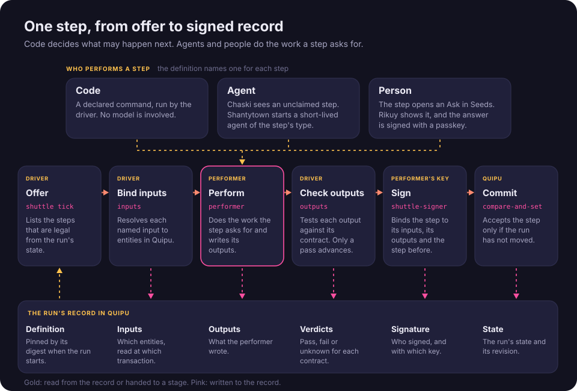

# Design: the orchestrator

**Status: proposed (2026-11-28).** Nothing on this page is built unless a
"today" column says so. [Signed runs, windowed export, freezable history](shuttle.md)
describes what Shuttle does now.

Shuttle records what happened. This design makes it decide what happens next:
a deterministic driver that moves a run from step to step, hands each step to
code, an agent or a person, checks what the step produced, and leaves a signed
record anyone can re-check.

<p align="center"></p>

## What this has to do

| # | requirement | today |
|---|---|---|
| 1 | A deterministic orchestrator drives runs | No driver. A caller runs `shuttle advance` for every step. `shuttle reconcile` advances steps performed by Seeds work items, and something outside Shuttle has to call it. |
| 2 | Agents and people are brought in when a step needs them | A performer is a free-form `--agent` string. No step says who performs it, and nothing asks a person. |
| 3 | Transitions are signed | Yes, with ed25519 over run, step, from, to, time and agent. The start of a run, the definition and the evidence are not signed. |
| 4 | Outputs are ensured where they can be | No step declares an output. Seed evidence stays in the local log, unsigned and unexported. |
| 5 | Workflows are configured in Quipu | A workflow is a local JSON file. Export sends step names only, so the graph cannot rebuild the state machine. A second `define` with the same name replaces the first. |
| 6 | Each step takes Quipu entities as inputs | No step declares an input. |
| 7 | Steps are auditable and verifiable | `shuttle verify` checks signatures. It needs the local log, and it does not check that the sequence was legal or that the signer was allowed to take the step. |
| 8 | Shuttle fits the rest of the stack | See [Fit with the stack](#fit-with-the-stack). |

Measured on the live Quipu on 2026-11-28: the open dataset holds 1,137 runs,
2,267 transitions and 6 definitions, all under the legacy names and none under
the `w3id.org/intigraph` names. Quipu reports workflow processing as available
and switched off (`GET /workflow/capabilities`: `enabled` false, signature
version 2).

## The model

Five things carry the design.

| thing | what it is |
|---|---|
| **Definition** | A workflow in Quipu: states, steps and, for each step, a performer, inputs, outputs and a deadline. It never changes once a run uses it. |
| **Run** | One pass through a definition. It pins the definition's digest and carries its parameters: the Quipu entities this run is about. |
| **Step record** | What one step read, what it produced and what was checked. |
| **Transition** | The signed move from one state to the next. The signature covers the step record. |
| **Verdict** | The result of one check: satisfied, unsatisfied or unknown. |

## One step, start to finish

1. **Offer.** The driver reads the run's state from Quipu and lists the steps
   that are legal from it.
2. **Bind inputs.** For each legal step, the driver resolves the step's named
   inputs to Quipu entities and writes down exactly what it read.
3. **Perform.** The step's performer does the work: a command, an agent or a
   person. It gets the bound inputs and writes the outputs the step declares.
4. **Check outputs.** The driver tests each output against its contract and
   records a verdict. Only a step whose every verdict is satisfied may advance.
5. **Sign.** The performer's key signs the transition. The signature binds the
   definition, the inputs, the outputs and the step before it.
6. **Commit.** Quipu accepts the transition only if the run is still in the
   state and revision the signer saw. The new state offers the next step.

A step that fails its check, or whose check cannot be read, leaves the run
where it is. The run moves again when the check passes, when a different legal
step is taken, or when the step's deadline sends it to the step the definition
names for that case.

## Definitions live in Quipu

A definition is a graph entity, written through Quipu's governed write path
and checked by shapes. A JSON file is how a person drafts one:

```json
{
  "name": "code-change",
  "version": 1,
  "parameters": {"change": "PullRequest", "repo": "GitRepo", "item": "WorkItem"},
  "initial": "opened",
  "terminal": ["merged", "rejected"],
  "steps": [
    {"step": "check", "from": "opened", "to": "checked",
     "performer": {"code": "forge.checks-green"},
     "inputs": {"change": "run.change"},
     "outputs": {"green": {"ask": "pr_checks_green", "with": {"change": "run.change"}}}},

    {"step": "waive-review", "from": "checked", "to": "approved",
     "performer": {"code": "policy.review-not-required"},
     "inputs": {"mode": {"ask": "repo_review_mode", "with": {"repo": "run.repo"}}},
     "outputs": {"waived": {"ask": "review_mode_is_none", "with": {"repo": "run.repo"}}}},

    {"step": "approve", "from": "checked", "to": "approved",
     "performer": {"agent": "reviewer"},
     "inputs": {"change": "run.change", "item": "run.item"},
     "outputs": {"verdict": {"shape": "ReviewVerdict"}},
     "deadline": "PT2H", "on_timeout": "escalate"},

    {"step": "request-changes", "from": "checked", "to": "opened",
     "performer": {"agent": "reviewer"},
     "inputs": {"change": "run.change", "item": "run.item"},
     "outputs": {"verdict": {"shape": "ReviewVerdict"}}},

    {"step": "escalate", "from": "checked", "to": "waiting-on-person",
     "performer": {"code": "ask.open"},
     "inputs": {"change": "run.change"},
     "outputs": {"ask": {"shape": "Ask"}}},

    {"step": "decide-approve", "from": "waiting-on-person", "to": "approved",
     "performer": {"person": "administrator"},
     "inputs": {"ask": "step.escalate.ask"},
     "outputs": {"decision": {"shape": "Decision"}}},

    {"step": "decide-reject", "from": "waiting-on-person", "to": "rejected",
     "performer": {"person": "administrator"},
     "inputs": {"ask": "step.escalate.ask"},
     "outputs": {"decision": {"shape": "Decision"}}},

    {"step": "merge", "from": "approved", "to": "merged",
     "performer": {"code": "forge.enqueue"},
     "inputs": {"change": "run.change"},
     "outputs": {"merged": {"ask": "pr_merged", "with": {"change": "run.change"}}}}
  ]
}
```

`repo_review_mode` is the stored query Shantytown's merge gate reads today.
The other query, shape and command names in the example are placeholders for
terms this work adds.

The rules:

- **`shuttle define FILE --publish`** validates the file and writes the
  definition to Quipu. A run starts only from a definition that is in Quipu.
- **A definition is identified by name and version, and fixed by its digest.**
  The digest is the SHA-256 of the definition in canonical form. Publishing
  different content under a name and version that exist is refused. A changed
  workflow is a new version.
- **A run pins the digest when it starts.** A run in flight finishes under the
  definition it started with.
- **The whole definition is in the graph:** states, steps, performers, inputs,
  outputs and deadlines. A reader can rebuild the state machine from Quipu
  alone.
- **Definitions ship in a pendant** with the agent types and Chaski reactions
  they need, so a deployment installs a workflow as one reviewed bundle.

## Inputs: Quipu entities attached to each step

A run starts with parameters, and each one is a Quipu entity:

```sh
shuttle start code-change run-820 \
  --with change=<pull request IRI> --with repo=<repository IRI> --with item=<work item IRI>
```

A step names its inputs. Each input comes from one of four sources, and there
are no expressions:

| source | written as | resolves to |
|---|---|---|
| A run parameter | `run.change` | The entity given at start. |
| An earlier step's output | `step.escalate.ask` | The entity that step produced. |
| A stored query | `{"ask": "repo_review_mode", "with": {...}}` | The rows the named Quipu query returns. |
| A constant | `const:none` | The literal value. |

When the driver binds a step's inputs it writes an **input manifest**: each
input's name, its source, the entities or rows it resolved to and the Quipu
transaction they were read at. The manifest's SHA-256 goes into the step
record, so the signature covers what the performer was given. Quipu keeps
history, so a later reader can ask for the same entities as they were at that
transaction.

An input that cannot be read, is truncated or times out is unknown. The step
is not offered, and the run waits. An unreadable input is never treated as
empty.

For an agent, the manifest is its task pendant: the knowledge the step needs
and nothing else.

## Outputs: checked where they can be

Each step names its outputs, and each output has a contract of one of four
kinds:

| kind | the check | an example |
|---|---|---|
| `shape` | The output entity conforms to a named SHACL shape in Quipu. | A review verdict names its reviewer, its target commit and its outcome. |
| `ask` | A stored query returns true. | The pull request is merged. |
| `digest` | A file or commit matches a recorded SHA-256 or commit id. | The built wheel is the one that was tested. |
| `attested` | No machine check. The performer's signature is the only assurance. | "I read the runbook." |

Each check writes a verdict: satisfied, unsatisfied or unknown. A step
advances only when every verdict is satisfied. Unknown never advances.

"Where they can be" is a visible property of a definition. Publishing a
definition reports how many of its steps are attested, and `shuttle audit`
marks each step of a run as checked or attested. A reader always knows which
steps rest on a check and which rest on a signature alone.

## Who performs a step

Every step names one performer.

**Code.** The performer is a declared command, the `Command` of Quechua's
capability shapes: a name, what it can reach (read, write, act, outward,
spend), how it runs and how it is undone. The driver runs it. No model is involved. The driver's own key signs the step, and
the signing broker holds that key.

**Agent.** The performer is an agent type: a harness, a prompt contract, a
budget and the steps it may sign. The run waits in its state with the step
unclaimed. A standing Chaski condition matches "a step for agent type T, no
live claim", and Shantytown starts a short-lived agent of that type. The agent
claims the step, gets the input manifest and a broker capability that signs
that step of that run and nothing else, and expires with the job. It does the
work, writes the outputs and asks Shuttle to advance. Shuttle checks the
outputs before it signs.

**Person.** The step opens an Ask in Seeds: the legal steps from this state as
options, a recommendation, a default and an expiry. Rikuy shows the Ask. The
person answers with a passkey, and Quipu verifies that signature when it
writes the answer. The driver takes the step the answer names, and the
transition points at the signed decision. Where passkey decisions are switched
off, a person step is a Seeds work item the person closes, which is how seed
steps work today.

**Deadlines bring a person in when needed.** A step can carry a deadline and
an `on_timeout` step. In the example, a review that no agent finishes in two
hours escalates to the administrator. An agent that fails, or a check that
stays unknown, reaches a person the same way.

## The driver

`shuttle tick` is the orchestrator. It is a pure function:

> definition + signed events + verdicts + the time it was given → the actions
> that are due

The actions are: run a code step, open a step for an agent to claim, open an
Ask, check a step's outputs, and take a deadline's `on_timeout` step. Each
action is keyed by run, step and visit, so a second tick over the same state
does nothing new.

- **Deterministic.** The same record gives the same actions. A replay test
  feeds recorded runs back through the driver and compares.
- **No model in the driver.** An agent or a person picks among the legal steps
  the driver offered and has to meet that step's contract. Neither can take a
  step the definition does not declare.
- **No daemon.** Chaski fires the tick: on a change to a run, and on a
  schedule for deadlines. Both are declared in Quipu.
- **Safe to run twice.** Quipu commits a transition only against the state and
  revision the signer saw. When two ticks race, one commits and the other does
  nothing.

Quipu holds a run's state. The local log stays as an outbox for a machine that
cannot reach Quipu, and it drains in order when Quipu returns.

## Signatures and the record

The signed message grows by one field. Quipu's version 2 message adds the
run's revision to today's message. Version 3 adds the digest of the step
record:

```text
shuttle-transition-v3|{run}|{step}|{from}|{to}|{at}|{agent}|{from_revision}|{record_sha256}
```

The step record is a graph entity with:

- the digest of the pinned definition;
- the digest of the input manifest;
- the output entities and the verdict for each contract;
- the signature of the previous transition in the run, which chains the steps
  in order;
- the kind of performer.

The start of a run is signed the same way, over the run's parameters.

Keys:

- A job's key and the driver's key live in the signing broker. A job gets a
  capability for its run and its steps, never a key.
- Crew keys move into the broker.
- Public keys are registered under Quipu's trust root, with a tier of `agent`
  or `human`. Quipu's write gate accepts only those registrations.
- A person signs with a passkey through Quipu's attested write.

## Audit and verification

`shuttle verify RUN` reads only Quipu and checks six things:

1. The run's definition matches the pinned digest.
2. Every step is legal from the state before it, in order.
3. Every signature verifies against a key that was registered and not revoked
   when the step was signed.
4. Every signer was allowed to take that step: the agent type, the person's
   role or the driver.
5. Every input manifest matches the entities as they were at the recorded
   transaction.
6. Every output contract still evaluates to the recorded verdict at that
   transaction.

It writes its result to Quipu as a verdict on the run, so "which runs have
been verified, by whom" is a query.

`shuttle audit RUN` prints the run for a person: each step with who performed
it, what it was given, what it produced, which checks passed and which steps
were attested.

Frozen months stay verifiable. Keys are registered outside the monthly graphs,
so freezing a month does not touch them.

## Fit with the stack

| tool | today | next |
|---|---|---|
| **Quipu** | Receives runs and transitions in monthly graphs and checks their shapes on write. Workflow processing is switched off on the live server. | Holds definitions, run state, step records and verdicts. Enforces legal steps, revisions and signatures at the write gate. Stored queries answer "what is waiting, and on whom". |
| **Quechua and Camayoc** | Workflow terms are split over three namespaces, and the live data uses the legacy one. | New terms (performer, input, output contract, step record, agent type, definition digest) are proposed in the `w3id.org/intigraph/quechua/ns#` namespace through the schema-proposal path. |
| **Chaski** | Signs scheduled occurrences through `shuttle scheduled`. Reactions cannot start a workflow. | A reaction can start a run. Standing conditions over run state recruit agents and fire the tick. |
| **Shantytown** | Reads open runs. Its job-run recording signs with the administrator's key. | Each short-lived job is one run with its own broker capability. Agent types bind to steps. Steps waiting on a person appear on that person's plate. |
| **Seeds** | A work item can perform a step. | An Ask performs a person step. Every run links to the work item it serves. |
| **Rikuy** | No connection. | Shows runs, the step each is waiting on and who it waits for. Its signed decisions answer person steps. |
| **Yupana** | Its edit guard can name a required workflow and does not start one. | A required workflow starts or joins a run, with the edited symbols as run parameters. |
| **Bobbin** | No connection. | Builds the context part of an agent's task pendant from the step's inputs. |
| **Tambo** | Installs `shuttle` and proves it with a real run. | Also installs `shuttle-signer`, and proves a run that is published, driven and verified from Quipu. |

## Plan

Each phase ships on its own and leaves today's commands working.

| phase | what ships | tracked work it serves |
|---|---|---|
| **0. Complete the record** | Export the whole definition and the evidence. Sign the start of a run. `verify` reads only Quipu and checks that the sequence is legal. Refuse to redefine a name with different content. Release the signing broker and have the installer link `shuttle-signer`. Bring the existing design page up to date. | aegis-za4f.19.2 (done, unreleased) |
| **1. Definitions in Quipu** | `define --publish`, digest pinning, run parameters, and the new terms. The two Shantytown job definitions move out of code and into Quipu. | aegis-za4f.19.1, aegis-za4f.17.2, aegis-m5s.3 |
| **2. Inputs, outputs and the step record** | Input manifests, the four output contracts, verdicts, the version 3 signature, and `shuttle audit`. Quipu accepts version 3. | aegis-za4f.17.2 |
| **3. The driver** | `shuttle tick`, code steps and deadlines. Chaski fires the tick. | aegis-za4f.17.3, aegis-6vf, aegis-za4f.21 |
| **4. Agents and people** | Agent types bound to steps, recruitment through Chaski and Shantytown, person steps through Seeds and Rikuy. | aegis-za4f.19.3, aegis-e579, aegis-j8z |
| **5. Enforce in Quipu** | Workflow processing and the transition write gate switched on. Registrations under the trust root. Crew keys in the broker. | aegis-za4f.19.4 |

**The first workflow to prove it** is the code-change lifecycle above, on one
repository whose review mode is `none`: `check` and `merge` are code steps
with `ask` contracts, and nothing waits on an agent or a person. The second is
a repository that requires review, which adds the agent step and the
escalation to a person.

## Decisions this needs

| # | decision | recommendation |
|---|---|---|
| 1 | How the signature covers inputs and outputs | Add one field, the step record's digest, as version 3. One signature then covers everything a step read and produced, and later additions change the record, not the message. Quipu has to accept version 3. |
| 2 | Whether Shuttle runs code steps itself | Yes. Shuttle today has no executor. Running declared commands inside the tick keeps code steps out of agent sessions, and each command's reach and undo are declared in Quipu. The alternative sends every code step through a Shantytown job. |
| 3 | How a person takes a step before passkey decisions are switched on | A Seeds work item the person closes, which works today. Move to passkey-signed answers when Rikuy's signed decisions are enabled. |
| 4 | When Quipu's enforcement is switched on | Last, as phase 5. It needs every writer on version 2 or later and the existing registrations moved under the trust root. Until then Shuttle checks what Quipu will later enforce. |

## What stays the same

- Shuttle has no daemon, queue or server of its own.
- Every run recorded today still verifies. Version 1 signatures stay valid.
- `define`, `start`, `advance`, `reconcile`, `export`, `verify` and
  `freeze-window` keep their meaning. A workflow with no performers, inputs or
  outputs behaves as it does now.
